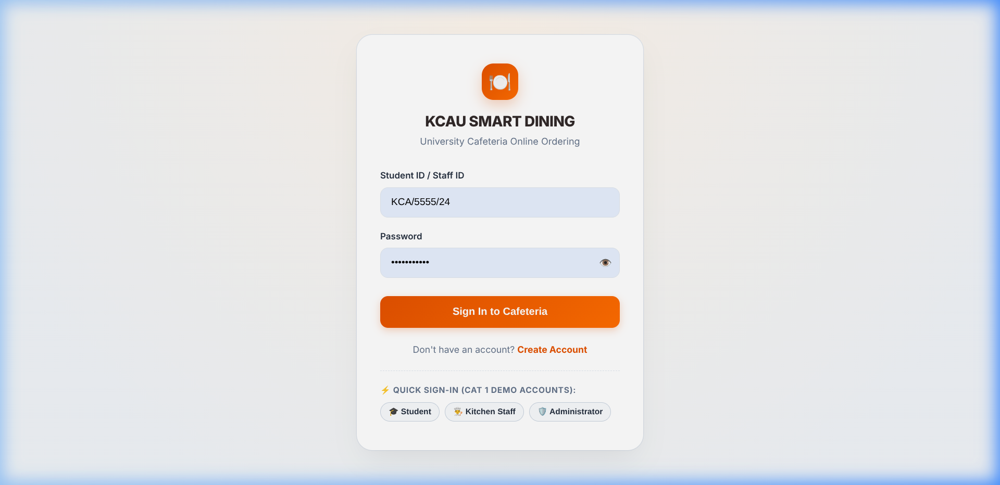
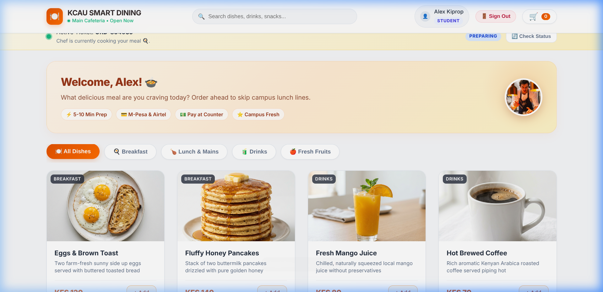
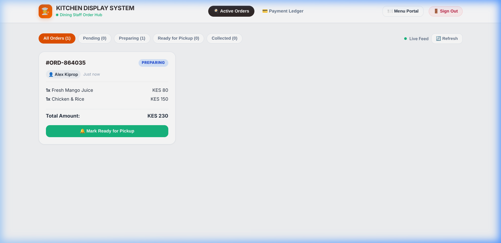
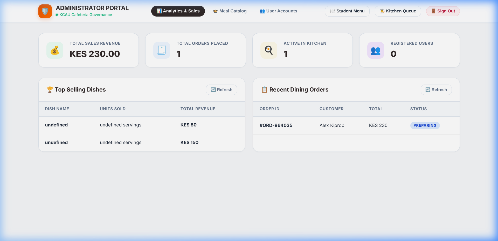

# KCAU SMART DINING SYSTEM 🍽️
### Continuous Assessment Test 1 (CAT 1) — Comprehensive Technical Deliverable

An enterprise-grade campus cafeteria online ordering and dining management platform engineered for **KCA University (KCAU)**. Built on a modular **Java backend (OpenJDK 25 with Project Loom Virtual Threads)** and backed by a persistent **SQLite relational database (`data/dining.db`)**, the system connects three dedicated portals: **Student Ordering Portal**, **Dining Staff Kitchen Display System**, and **Administrator Governance Portal**.

---

## 🌟 Live Deployments & Repository Links

* **GitHub Repository:** [https://github.com/solomon476/KCAU-SMART-DINING-SYSTEM](https://github.com/solomon476/KCAU-SMART-DINING-SYSTEM)
* **Vercel Production Deployment:** [https://kca-cafeteria.vercel.app](https://kca-cafeteria.vercel.app)
* **Deliverable 1 — CAT 1 Technical Documentation (PDF):** [KCAU_Smart_Dining_System_CAT1_Technical_Documentation.pdf](KCAU_Smart_Dining_System_CAT1_Technical_Documentation.pdf)
* **Deliverable 2 — Java Source Code (PDF):** [KCAU_SMART_DINING_JAVA_SOURCE_CODE.pdf](KCAU_SMART_DINING_JAVA_SOURCE_CODE.pdf)
* **Deliverable 2 — Java Source Code (DOCX):** [KCAU_SMART_DINING_JAVA_SOURCE_CODE.docx](KCAU_SMART_DINING_JAVA_SOURCE_CODE.docx)
* **Deliverable 3 — Database Documentation (PDF):** [KCAU_Smart_Dining_Database_Documentation.pdf](KCAU_Smart_Dining_Database_Documentation.pdf)
* **Deliverable 3 — Database Documentation (DOCX):** [KCAU_Smart_Dining_Database_Documentation.docx](KCAU_Smart_Dining_Database_Documentation.docx)
* **Deliverable 4 — Testing Evidence & Report:** [TESTING_EVIDENCE.md](TESTING_EVIDENCE.md)

---

## 📸 Screenshots of Application Functions

| 1. Authentication & Role Selector | 2. Student Menu & Live Cart Dock |
| :---: | :---: |
|  |  |
| *Multi-role login with ⚡ Quick Sign-In chips* | *Dynamic menu from Java with category filters & tray* |

| 3. Kitchen Display System (Staff Portal) | 4. Administrator Governance Portal |
| :---: | :---: |
|  |  |
| *Live queue with PREPARING & READY status buttons* | *Real-time sales KPIs, dish rankings, and catalog toggle* |

---

## 🏛️ System Architecture

```
+-------------------------------------------------------------------------------------------------------+
|                                    THREE CONNECTED USER INTERFACES                                    |
|   1. STUDENT PORTAL           : Browse Menu from Java, Tray Cart, Simulated M-Pesa STK, Receipt & Track |
|   2. DINING STAFF PORTAL      : Live Kitchen Queue, Status Controls (PREPARING, READY, COLLECTED), Ledger|
|   3. ADMINISTRATOR PORTAL     : Real-time Sales KPIs, Meal Availability Toggle, Add Dish, Role Control  |
+-------------------------------------------------------------------------------------------------------+
                                                   |
                                     REST JSON APIs over HTTP (Port 3000)
                                                   v
+-------------------------------------------------------------------------------------------------------+
|                                  MODULAR JAVA APPLICATION ENGINE                                      |
|   - com.kcau.dining.Server    : Virtual Thread HTTP Server (com.sun.net.httpserver)                   |
|   - com.kcau.dining.handler.* : UserHandler, MenuHandler, OrderHandler, PaymentHandler, ReportHandler |
|   - com.kcau.dining.service.* : UserService, MenuService, OrderService, PaymentService, ReportService |
|   - com.kcau.dining.model.*   : User, MenuItem, Order, OrderItem, Payment                             |
+-------------------------------------------------------------------------------------------------------+
                                                   |
                                            JDBC Connectivity
                                                   v
+-------------------------------------------------------------------------------------------------------+
|                                    RELATIONAL SQLITE DATABASE                                         |
|   - data/dining.db            : Foreign-keyed tables (users, menu_items, orders, order_items, payments) |
|   - DatabaseInitializer.java  : Automated DDL table creation and initial seed data                    |
+-------------------------------------------------------------------------------------------------------+
```

---

## 📁 Complete Java Source Code Organization

```
.
├── Server.java                        # Root server launcher (auto-delegating to modular engine)
├── User.java                          # Root-level model alias for User
├── MenuItem.java                      # Root-level model alias for MenuItem
├── Order.java                         # Root-level model alias for Order
├── run-java.sh                        # Shell script to start the Java backend
├── package.json                       # Scripts for npm start
├── lib/                               # Bundled JDBC & logging libraries (Zero external install required)
│   ├── sqlite-jdbc.jar                # Native SQLite JDBC driver
│   ├── slf4j-api.jar                  # Logging interface
│   └── slf4j-simple.jar              # Simple SLF4J binding
├── data/
│   └── dining.db                      # Persistent SQLite relational database
├── src/main/java/com/kcau/dining/     # Modular Java enterprise architecture
│   ├── Server.java                    # Core HTTP server with REST routing & Virtual Threads
│   ├── database/
│   │   ├── DatabaseConnection.java    # Thread-safe SQLite connection pool manager
│   │   └── DatabaseInitializer.java   # Automated table creation (DDL) and seed injector
│   ├── model/
│   │   ├── User.java                  # User account entity (roles: student, staff, admin)
│   │   ├── MenuItem.java              # Food catalog entity (price, category, availability)
│   │   ├── Order.java                 # Master order ticket with status lifecycle
│   │   ├── OrderItem.java             # Order line item with quantity & unit price
│   │   └── Payment.java               # Transaction ledger entity
│   ├── service/
│   │   ├── UserService.java           # PBKDF2 password hashing & authentication
│   │   ├── MenuService.java           # Food catalog management & availability toggle
│   │   ├── OrderService.java          # ACID transactional order creation & status updates
│   │   ├── PaymentService.java        # Payment ledger recording & queries
│   │   └── ReportService.java         # SQL aggregate calculations (revenue, popularity)
│   └── handler/
│       ├── HttpHelper.java            # CORS, JSON serialization, HMAC-SHA256 JWT tokens
│       ├── UserHandler.java           # /api/signup, /api/login, /api/me, /api/users, /api/users/role
│       ├── MenuHandler.java           # /api/menu, /api/menu/availability, /api/menu/edit
│       ├── OrderHandler.java          # /api/orders, /api/orders/my, /api/orders/status
│       ├── PaymentHandler.java        # /api/payments
│       └── ReportHandler.java         # /api/reports/summary, /api/reports/sales
├── public/                            # Single Page Application assets
│   ├── index.html                     # Responsive SPA interface with all 3 portals
│   ├── style.css                      # University terracotta design system
│   ├── app.js                         # Frontend controller communicating with Java REST API
│   └── images/                        # Cafeteria menu photographs
├── screenshots/                       # Application functional screenshots
├── docs/                              # Technical documentation source
└── TESTING_EVIDENCE.md                # Comprehensive functional test case logs
```

---

## 🗄️ Database & Schema Configuration

The application uses **SQLite (`data/dining.db`)** configured with 5 relational tables:

1. **`users`**: `id` (PK), `name`, `student_id` (UNIQUE), `password_hash`, `role` (`student`, `staff`, `admin`), `created_at`.
2. **`menu_items`**: `id` (PK), `name`, `category`, `price`, `description`, `image`, `available` (BOOLEAN).
3. **`orders`**: `order_id` (PK), `user_id` (FK), `customer_name`, `total_amount`, `order_status` (`PENDING`, `PREPARING`, `READY`, `COLLECTED`, `CANCELLED`), `created_at`.
4. **`order_items`**: `id` (PK), `order_id` (FK), `food_id`, `food_name`, `quantity`, `unit_price`.
5. **`payments`**: `payment_id` (PK), `order_id` (FK), `method`, `amount`, `reference` (UNIQUE), `status`, `created_at`.

---

## 🚀 How to Run the Application

### Prerequisites
* Java Development Kit (JDK 17, 21, or 25).
* Git.

### Step 1: Clone the Repository
```bash
git clone https://github.com/solomon476/KCAU-SMART-DINING-SYSTEM.git
cd KCAU-SMART-DINING-SYSTEM
```

### Step 2: Run the Code in the Terminal (Interactive Console or Backend Server)

You can run the system directly in your terminal using any of the following modes:

#### Option 1: Interactive Terminal Console Application (Recommended for Terminal Screenshots)
Runs fully inside your laptop terminal without needing a browser. Displays formatted ASCII tables for **Menus**, **Orders**, **Users**, and **Payments**, and lets you test login, place orders, and update kitchen status:
```bash
./terminal-app.sh
# or
bash terminal-app.sh
```

#### Option 2: Quick ASCII Tables Output (Instant Terminal Screenshot)
Instantly dumps all SQLite tables (menus, orders, users, payments) to the terminal and exits:
```bash
./show-tables.sh
# or
bash show-tables.sh
```

#### Option 3: Full Java Web Backend Server
Starts the HTTP server on port 3000, displays the database tables, and serves the 3 connected web portals:
```bash
# Method A: Using the shell script (Recommended)
./run-java.sh

# Method B: Direct Java execution with bundled libraries
java -cp "lib/*:src/main/java" src/main/java/com/kcau/dining/Server.java

# Method C: Using npm script
npm start
```

### Step 3: Open in Browser (If running Web Backend)
Visit **`http://localhost:3000/`** to access the Student, Kitchen Staff, and Admin web portals.

---

## 👥 Default Test Accounts (CAT 1 Demo Accounts)

Use the **⚡ Quick Sign-In chips** on the login screen to sign in with one click:

| Role | Student / Staff ID | Password | Portal Features Accessible |
| :--- | :--- | :--- | :--- |
| 🎓 **Student** | `KCA/1234/23` | `password123` | Dynamic menu, live tray cart, simulated M-Pesa STK checkout, digital receipt, active order tracking banner |
| 👨‍🍳 **Dining Staff** | `STAFF/001` | `password123` | Kitchen Display System with live orders queue, status buttons (`PREPARING`, `READY`, `COLLECTED`), payment ledger |
| 🛡️ **Administrator** | `ADMIN/001` | `password123` | Real-time sales KPIs, dish popularity rankings, toggle meal availability, add new dishes, user role assignment |

---

## 📡 REST API Reference

| HTTP Method | Endpoint | Request Body | Description |
| :--- | :--- | :--- | :--- |
| `POST` | `/api/signup` | `{ name, studentId, password, role }` | Register new user in SQLite with PBKDF2 password hashing |
| `POST` | `/api/login` | `{ studentId, password }` | Authenticate and issue signed HMAC-SHA256 JWT |
| `GET` | `/api/me` | *Bearer Token Header* | Validate active JWT session |
| `GET` | `/api/users` | *None* | List all registered accounts (Admin only) |
| `PUT` | `/api/users/role` | `{ userId, role }` | Change user role to student, staff, or admin |
| `GET` | `/api/menu` | *Optional ?category=* | Retrieve complete food catalog with availability flags |
| `POST` | `/api/menu` | `{ name, category, price, desc, image }` | Add a new dish to the cafeteria catalog |
| `PUT` | `/api/menu/availability`| `{ foodId, available: boolean }` | Toggle dish availability between In Stock and Sold Out |
| `POST` | `/api/orders` | `{ userId, customerName, total, items }` | Transactional ACID creation of order and line items |
| `GET` | `/api/orders` | *None* | Retrieve all orders for kitchen display queue |
| `PUT` | `/api/orders/status` | `{ orderId, status }` | Update order lifecycle status |
| `POST` | `/api/payments` | `{ orderId, method, amount, ref, status }`| Record transaction in cafeteria payment ledger |
| `GET` | `/api/payments` | *None* | List all payment records |
| `GET` | `/api/reports/summary`| *None* | Calculate real-time revenue and order counts |
| `GET` | `/api/reports/sales` | *None* | Ranking of dishes by quantity sold and revenue |

---

## 🧪 Testing Evidence

All test cases, curl commands, database verification queries, and outputs are documented in:
👉 [TESTING_EVIDENCE.md](TESTING_EVIDENCE.md)

---

## 📄 Documentation Deliverables

1. **CAT 1 Project & Technical Report (PDF):**
   * [KCAU_Smart_Dining_System_CAT1_Technical_Documentation.pdf](KCAU_Smart_Dining_System_CAT1_Technical_Documentation.pdf)
   * HTML source: [docs/code_guide.html](docs/code_guide.html)
2. **Complete Java Source Code Document (PDF & DOCX):**
   * [KCAU_SMART_DINING_JAVA_SOURCE_CODE.pdf](KCAU_SMART_DINING_JAVA_SOURCE_CODE.pdf) (56 pages, formatted with Consolas monospaced typography, metadata banners, and syntax highlighting)
   * Word source document: [KCAU_SMART_DINING_JAVA_SOURCE_CODE.docx](KCAU_SMART_DINING_JAVA_SOURCE_CODE.docx)
   * Generation automation script: [build_java_source_code_doc.py](build_java_source_code_doc.py)

---

## 👤 Author

* **Solomon** — [solomon476](https://github.com/solomon476)
* KCA University Smart Dining System — CAT 1 Submission
